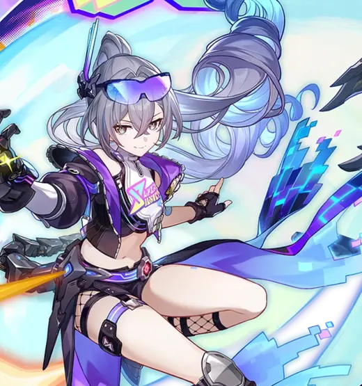
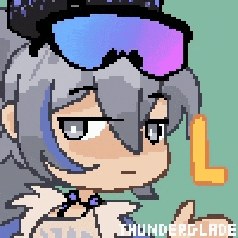
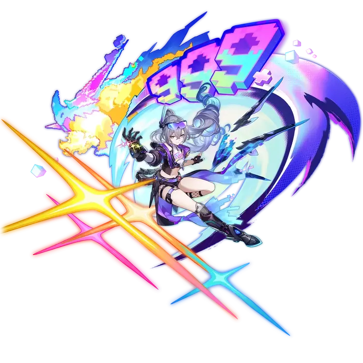
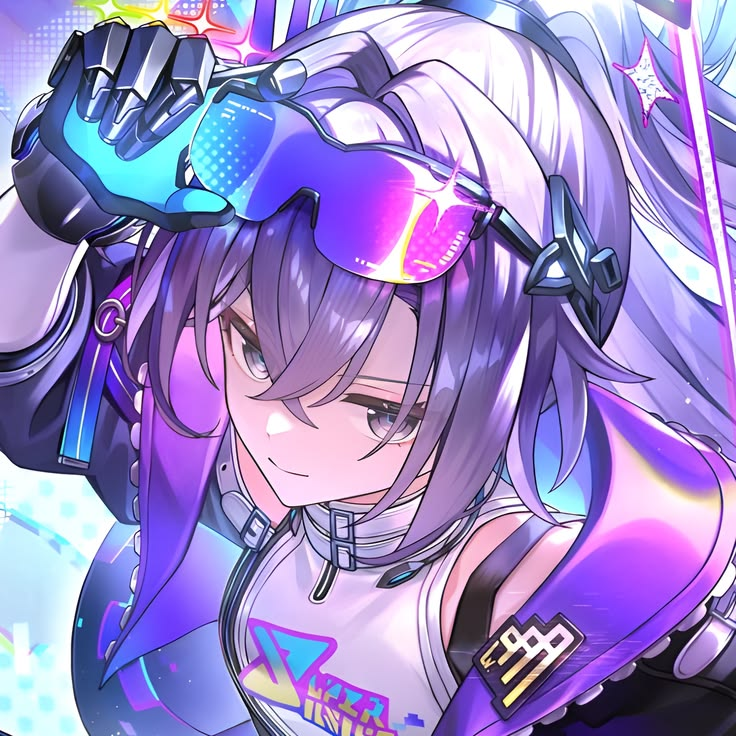
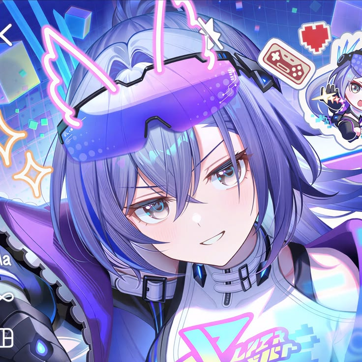
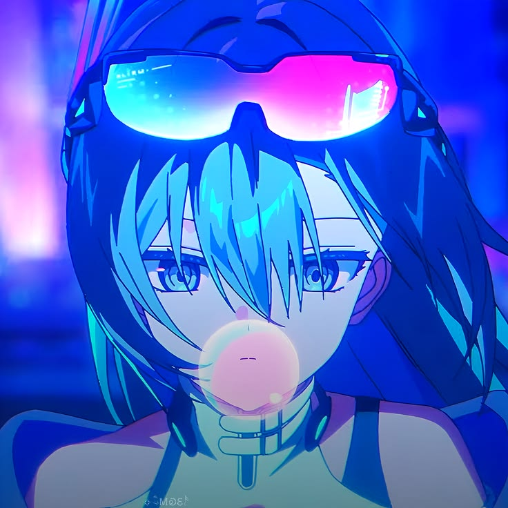
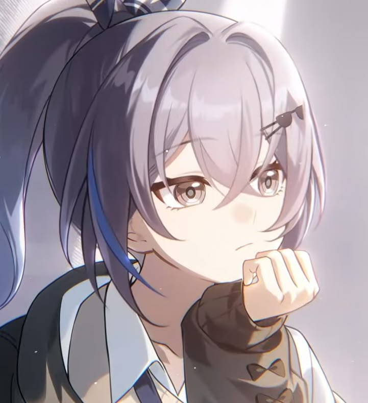

<!-- ═══════════════════════════  SILVER WOLF · LV.999 · v2  ═══════════════════════════ -->

<div align="center">


<br/>

<a href="https://discord.gg/NbBGsPKFjP"></a>
<a href="https://t.me/tsulinks"></a>
<a href="https://twitter.com/_1tsubasa"></a>
<a href="https://guns.lol/tsubabadev"></a>


</div>

<br/>

## `01` &nbsp;// &nbsp;Player Profile



I'm **Tsubasa**, a full-stack developer from 🇷🇸 Yugoslavia. I build web platforms, APIs and backend
services end-to-end — from database schema to the last pixel of the UI — and I treat every project like a
ranked match: read the map, pick the right build, execute cleanly.

```yaml
player:      Tsubasa  (mrtsubasa)
class:       Full-stack Developer
region:      Yugoslavia 🇷🇸
main_build:  TypeScript · Node.js · Go
playstyle:   Adaptive · Strategic · Passionate
guild:       Clarity
side_quests: iHorizon  (contributor)
languages:   English · Français
interests:   Anime · Gaming · Strategy
```

<sub><i>"I stay in the shadows to shine brighter when it truly matters."</i></sub>

<br clear="right"/>

## `02` &nbsp;// &nbsp;What I Do

<table>
<tr>
<td width="33%" valign="top">

**🌐 Web Platforms**

Modern front-ends with **React** & **Next.js**, typed end-to-end with **TypeScript**, styled with **Tailwind**.
Focus on performance, accessibility and clean component architecture.

</td>
<td width="33%" valign="top">

**⚙️ Backend & APIs**

REST services and real-time systems with **Node.js**, **Go**, **Laravel** and **Symfony**.
Data modelled in **PostgreSQL** / **MongoDB** through **Prisma**.

</td>
<td width="33%" valign="top">

**🛠️ Tooling & Infra**

Containerised deployments with **Docker**, CI with **GitHub Actions**, and fast runtimes like
**Bun** & **Deno**. Automation wherever it saves time.

</td>
</tr>
</table>

## `03` &nbsp;// &nbsp;Skill Tree



| Branch | Equipped |
| :-- | :-- |
| **Languages** |  |
| **Frontend** |  |
| **Backend** |  |
| **Data** |  |
| **DevOps** |  |

<details>
<summary><b>⚡ Currently leveling up</b></summary>
<br/>

-  **Rust** — systems programming, performance-critical services
-  **Bun** /  **Deno** — next-gen JS runtimes and tooling
-  **Go** — concurrency patterns and scalable backends

</details>

<br clear="right"/>

## `04` &nbsp;// &nbsp;Active Quests



<table>
<tr><td>

### 💠 [Clarity](https://discord.gg/NbBGsPKFjP)
`MAIN QUEST` &nbsp;·&nbsp; `IN PROGRESS`

My current focus — a project and community I'm building from the ground up.
Join the Discord to follow development and get early access.

</td></tr>
<tr><td>

### 🤝 [iHorizon](https://github.com/iHorizon)
`SIDE QUEST` &nbsp;·&nbsp; `CONTRIBUTOR`

Open-source contributions to the iHorizon organisation.

</td></tr>
</table>

<br clear="right"/>

## `05` &nbsp;// &nbsp;Combat Stats

<div align="center">


</div>

## `06` &nbsp;// &nbsp;Battle Log


## `07` &nbsp;// &nbsp;Gallery

<div align="center">



</div>

## `08` &nbsp;// &nbsp;Open a Channel



Got a project, a bug worth hunting, or an idea worth building? Reach out — I usually answer fastest on Discord.

| Platform | Handle |
| :-- | :-- |
|  &nbsp;Discord | `1tsubasa` · [Clarity server](https://discord.gg/NbBGsPKFjP) |
|  &nbsp;X / Twitter | [`@_1tsubasa`](https://twitter.com/_1tsubasa) |
|  &nbsp;GitHub | [`mrtsubasa`](https://github.com/mrtsubasa) |
|  &nbsp;GitLab | `1Tsubasa` |
| ✈️ &nbsp;Telegram | [`tsulinks`](https://t.me/tsulinks) |
| 🎧 &nbsp;Vybe | `1tsubasa` |

<br clear="right"/>

<div align="center">

<br/>

<sub><code>&gt; session terminated · thanks for visiting · see you in the next run</code></sub>


</div>
